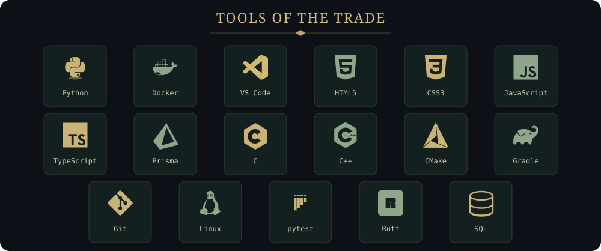
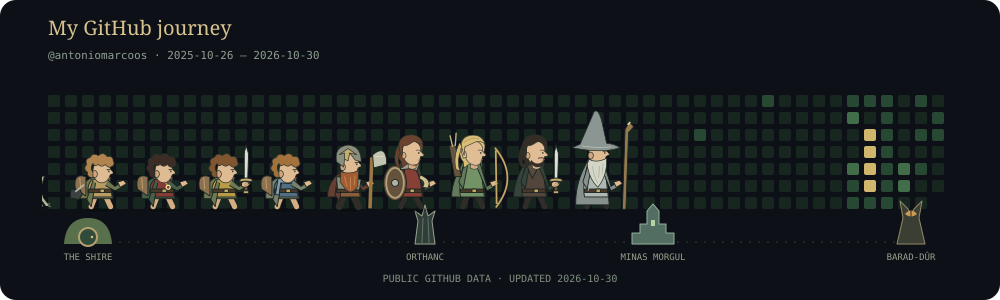
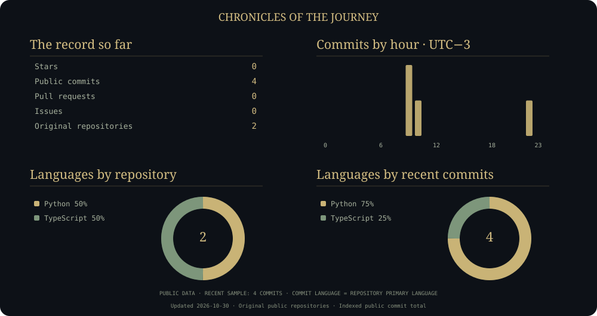

 

**Software development · Artificial intelligence · Linux**

I like building things and figuring out how they work, from web apps to low-level systems.

🎮 Games &nbsp; · &nbsp; 🎸 Guitar &amp; Rock &nbsp; · &nbsp; 💚 Ahgase &nbsp; · &nbsp; 📖 Tolkien

  

  

  

 

 

*“Not all those who wander are lost.”*  
J. R. R. Tolkien

